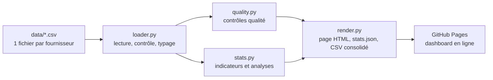

# Catalogue eSIM : tableau de bord automatisé

Test technique MyBestSim, partie 1 (Data & automatisation), réalisé par Nicolas Brecqueville.

**Dashboard en ligne : https://brecqueville.github.io/mybestsim-dashboard/**

Le programme lit les fichiers CSV des fournisseurs, contrôle et nettoie les données, calcule les statistiques clés et publie une page web. Il se relance tout seul à chaque nouvel import et une fois par jour. La page s'ouvre dans n'importe quel navigateur, sans compte ni installation.

## Les indicateurs demandés

Valeurs calculées sur les 18 fichiers fournis (5 056 lignes) :

| # | Indicateur | Valeur | Règle de calcul |
|---|---|---|---|
| 1 | Nombre total de cartes eSIM | **5 056** | Une ligne valide = un produit, identifié par son SKU (tous distincts) |
| 2 | Produits à plus de 100 € | **56** (1,1 %) | Prix strictement supérieur à 100 € |
| 3 | Fourchette de prix | **5,36 € à 154,63 €** | eSIM Irlande 1 Go 7 jours (aloSIM) → eSIM Europe Illimité 30 jours (aloSIM) |
| 4 | Data moyenne par carte | **14,5 Go** (médiane 5 Go) | Moyenne des 4 403 forfaits chiffrés ; les 653 forfaits illimités sont exclus de ce seul calcul |
| 5 | Prix moyen | **29,30 €** (médiane 20,70 €) | Moyenne arithmétique de tous les prix |
| 6 | Répartition par fournisseur | **18 fournisseurs**, d'Airalo (722 cartes) à 4S eSIM (92) | Graphique et tableau détaillé dans le dashboard |

Le dashboard permet aussi de **filtrer ces indicateurs par fournisseur**, par exemple [Airalo](https://brecqueville.github.io/mybestsim-dashboard/?fournisseur=Airalo).

## Les statistiques en plus (bonus)

Je les ai choisies pour leur utilité pour un comparateur d'eSIM :

- **Ce que rapporte la comparaison** : pour un même forfait (même destination, même volume, même durée), l'offre la moins chère coûte en moyenne 6 % de moins que la moyenne des offres, et 11 % de moins que la plus chère. L'écart va jusqu'à 39 %.
- **Aucun fournisseur n'est le moins cher partout** : le « champion » ne l'est que sur 35 % des forfaits où il a un concurrent.
- **Prix au Go selon le volume** : de 6,71 €/Go (forfait 1 Go) à 1,18 €/Go (forfait 50 Go).
- **Effet 4G / 5G** : en prix médian, la 5G paraît 33 % plus chère, mais l'écart n'est que de 0,4 % à forfait identique. C'est un effet de mix : la 5G est surtout présente sur les forfaits illimités.
- **Forfaits multi-pays** : ils coûtent 34 % de plus au Go que les forfaits pays.
- **Destinations** : couverture et prix au Go pour chacune des 54 destinations.
- **Forfaits illimités** : le prix d'une journée selon la durée (4,93 € sur 7 jours, 2,70 € sur 30 jours).
- **Un comparateur d'offres** : toutes les offres pour une destination, un volume et une durée, de la moins chère à la plus chère.
- **Qualité des données** : les contrôles passés à chaque import, et leurs résultats.

Les textes de la section « Ce que disent les données » sont **rédigés par le programme à partir des chiffres** : ils se mettent à jour avec les données.

## Choix assumés

Le sujet laisse des zones d'interprétation. Voici mes choix et leurs raisons :

1. **Forfaits illimités et moyenne de data.** 653 forfaits « Illimité » n'ont pas de volume (`data_gb` vide). Les compter pour 0 Go ferait baisser la moyenne à tort ; leur inventer un plafond serait arbitraire. Je les exclus donc de la moyenne de data, et seulement d'elle, et j'affiche leur nombre à côté.
2. **« Plus de 100 € »** = strictement supérieur à 100 €. Aucun produit ne coûte exactement 100 € : le choix ne change pas le résultat, mais la règle est écrite.
3. **Doublons possibles.** 219 groupes (458 produits) ont la même fiche technique (fournisseur, destination, volume, durée, réseau, recharge) mais un prix différent. Leurs SKU sont distincts : je les garde comme des produits à part et je les signale « à vérifier » plutôt que de supprimer des lignes au hasard.
4. **Le piège du code « NA ».** `NA` désigne l'Amérique du Nord. Par défaut, pandas le lit comme une valeur manquante : 192 produits perdraient leur destination. Les fichiers sont donc lus en texte strict, et un test le vérifie.
5. **Codes de zone non ISO.** `EU`, `AS`, `NA` et `WW` sont des zones multi-pays (Europe, Asie, Amérique du Nord, Monde). En ISO, `AS` désigne les Samoa américaines et `NA` la Namibie : ils sont traités comme des zones, pas comme des pays.
6. **Aucune correction silencieuse.** Une ligne invalide (prix non numérique ou négatif, autre devise, durée nulle, SKU en double…) est écartée avec son motif, et le rapport qualité l'affiche. Sur les données fournies, aucune ligne n'a été écartée.
7. **Une page statique plutôt qu'une application serveur.** La page s'ouvre instantanément, sans serveur à maintenir ni appli « en veille » à réveiller. L'hébergement est gratuit et chaque version est tracée dans Git.
8. **Python calcule, le navigateur affiche.** Tous les chiffres sont calculés et testés en Python. Le JavaScript ne fait que les afficher et les filtrer : il n'y a qu'une source de vérité.

## Comment ça marche



Le workflow [`.github/workflows/dashboard.yml`](.github/workflows/dashboard.yml) enchaîne **tests → calcul → publication**. Il se déclenche :

- à chaque nouvel import (push de fichiers dans `data/`) ;
- chaque jour à 7 h, heure de Paris ;
- à la demande, depuis l'onglet Actions.

Si un contrôle qualité signale un problème, il apparaît en annotation dans l'onglet Actions. Si les tests échouent, la page en ligne n'est pas remplacée et GitHub prévient par e-mail.

```text
data/                  CSV fournisseurs (entrée)
esim_dashboard/
├── loader.py          lecture, contrôle du schéma, typage, rejets motivés
├── quality.py         contrôles qualité affichés dans le dashboard
├── stats.py           tous les calculs : indicateurs, bonus, enseignements rédigés
├── render.py          génération du site (HTML, stats.json, CSV consolidé)
├── formatting.py      nombres à la française (5 056 ; 29,30 € ; 1,1 %)
├── templates/         page HTML (Jinja2)
└── static/            CSS et JavaScript d'affichage (sans dépendance externe)
tests/                 tests unitaires (pytest)
```

## Lancer le projet en local

Il faut Python 3.11 ou plus récent.

```bash
python -m venv .venv
source .venv/bin/activate
pip install -r requirements-dev.txt
python -m pytest
python -m esim_dashboard --data data --out site
```

Ouvrez ensuite `site/index.html` dans un navigateur.

## Brancher les vrais imports quotidiens

Aujourd'hui, les CSV sont versionnés dans `data/` : un nouveau fichier poussé dans le dépôt met le dashboard à jour en 1 à 2 minutes. En production, deux options simples :

- **Dépôt automatique** : un script ou un outil no-code (Make, n8n, Zapier) commite les CSV reçus chaque matin.
- **Collecte dans le workflow** : une étape télécharge les fichiers depuis la source (S3, SFTP, Google Drive, API des fournisseurs) avant l'étape « Générer le dashboard ».

Le programme découvre tout seul les fichiers présents. Un nouveau fournisseur n'exige aucune modification de code, et un fichier mal formé est signalé sans bloquer les autres.

## Exports

Chaque publication produit aussi :

- [`stats.json`](https://brecqueville.github.io/mybestsim-dashboard/stats.json) : toutes les statistiques, réutilisables par un autre outil (alerte Slack, tableur…) ;
- [`catalogue-consolide.csv`](https://brecqueville.github.io/mybestsim-dashboard/catalogue-consolide.csv) : le catalogue nettoyé et fusionné, au format Excel français (point-virgule, virgule décimale).

## Méthode et usage de l'IA

Comme le sujet l'encourage, j'ai travaillé avec un agent IA (Claude Code). Il a audité les données, puis écrit le code, les tests et la page, et contrôlé le rendu dans un navigateur. Chaque chiffre a été recoupé avec un calcul indépendant, et les choix de méthode ci-dessus ont été tranchés et documentés avant d'écrire le code.
